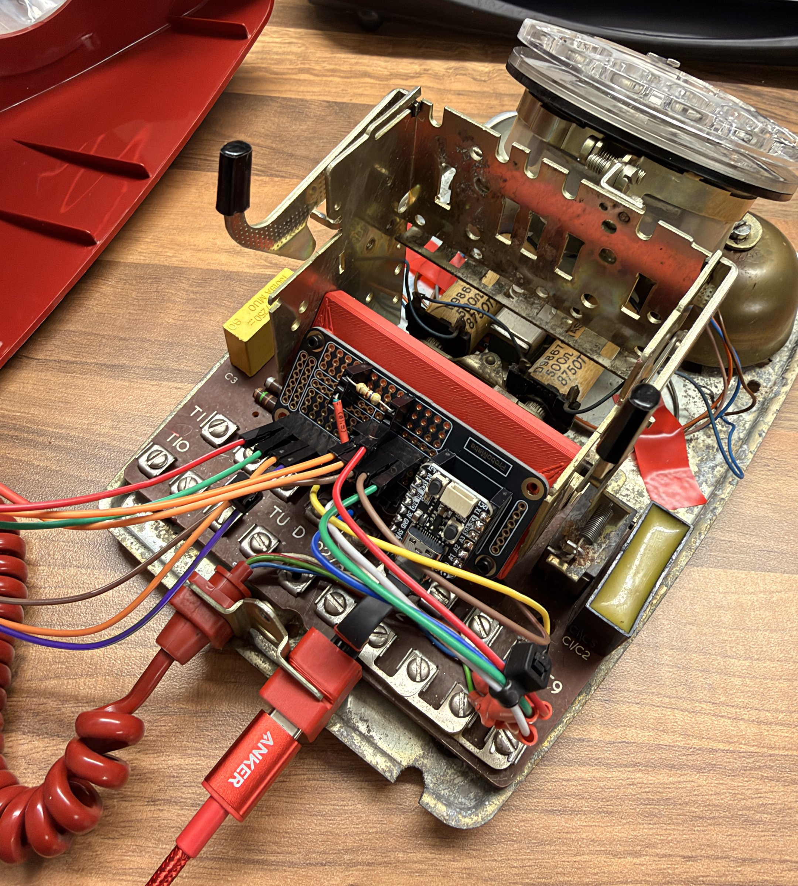
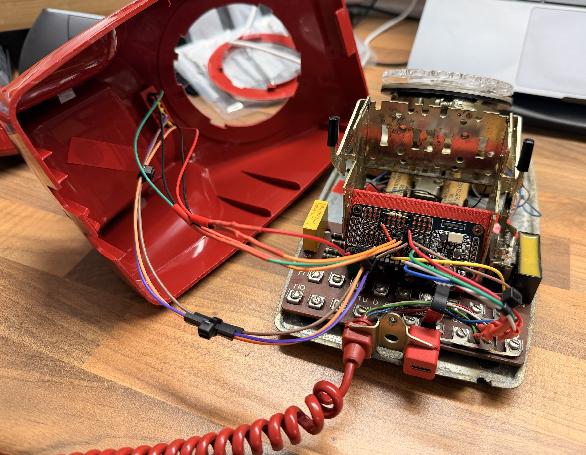

# Build guide

This guide shows you how to make a Hotline from a GPO 746 rotary-dial telephone (the prototype is an original red GPO 746): the parts, the printed parts, the wiring, the firmware and the final test. The printed parts fit the GPO 746. Other phones need changes to the printed parts, and can have other terminal numbers.

The build needs no new holes in the case, and you do not cut anything in the original phone. You can restore the phone later.

Warning: never connect the finished phone to a telephone line. The line voltage, and the ringing voltage, can injure you and damage the electronics and the Mac. Remove the phone's line cord if it still has one.

## Contents

1. [Parts and tools](#1-parts-and-tools)
2. [Print the parts](#2-print-the-parts)
3. [Open the phone](#3-open-the-phone)
4. [Make the handset](#4-make-the-handset)
5. [Make the ProtoMate board](#5-make-the-protomate-board)
6. [Fit the parts in the base](#6-fit-the-parts-in-the-base)
7. [Fit the top panel](#7-fit-the-top-panel)
8. [Connect the wires](#8-connect-the-wires)
9. [Flash the firmware](#9-flash-the-firmware)
10. [Test](#10-test)
11. [Close the phone](#11-close-the-phone)

## 1. Parts and tools

### Electronics

| Part | Use | Source |
| --- | --- | --- |
| Adafruit QT Py RP2040 | Controller: USB microphone, USB keyboard, earpiece drive | [The Pi Hut](https://thepihut.com/products/adafruit-qt-py-rp2040?variant=39922851446979) |
| Adafruit MAX4466 electret mic amplifier (ADA1063) | Microphone, in the handset | [The Pi Hut](https://thepihut.com/products/adafruit-electret-microphone-amplifier-max4466-with-adjustable-gain?variant=27739195601) |
| ProtoMate for XIAO | Board for the QT Py and the wiring | [The Pi Hut](https://thepihut.com/products/protomate-for-xiao?variant=54467240624513) |
| USB-C extension cable, 90 degree, flat, male to female | USB-C socket in the back of the phone | [Amazon UK](https://www.amazon.co.uk/dp/B0H8X1JM1S) |
| SPDT ON-OFF-ON latching miniature toggle switch (6 mm hole) | Mode switch | [The Pi Hut](https://thepihut.com/products/spdt-on-off-on-latching-miniature-toggle-switch?variant=42474411557059) |
| 3 mm 12 V prewired LEDs with holders, green and red (built-in resistor) | Status lights | [Amazon UK](https://www.amazon.co.uk/dp/B0B74CQSR6) |
| 470 ohm resistor, 1/4 W | In series with the earpiece | [The Pi Hut](https://thepihut.com/products/through-hole-resistors-470-ohm-5-1-4w-pack-of-25?variant=27740109201) |
| USB-C data cable | From the phone to the Mac | |

### From the old phone

- The case, the base and the dial (the dial is only decoration now).
- The handset and its earpiece.
- The hook switch, with its screw terminals on the original phone board. The original circuit stays in place.
- The 4-wire curly cord.
- The square hole in the top of the case, behind the dial. The Top Panel fits in it.

### Small parts

- Headers for the QT Py, so it plugs into the ProtoMate.
- Two 1x4 female headers, and male header pins for the cord wire ends.
- Crimp fork lugs, for the wires to the screw terminals of the hook switch (like the original wiring).
- Hook-up wire, in the colours of the [wiring diagram](wiring.md) if you can.
- M2 x 8 mm self-tapping hex socket head screws, for all the printed parts and the ProtoMate.
- Heat-shrink tube.

### Tools

- Soldering iron and solder.
- Multimeter.
- Wire strippers, side cutters and a crimping tool for the fork lugs.
- Small screwdrivers, and a 1.5 mm hex key for the M2 screws.
- A 3D printer, or a printing service.
- A Mac with the build tools (see [Firmware](firmware.md#build)).

## 2. Print the parts

Hotline has seven printed parts: the board mount, the two USB-C port parts, the two top panel parts, and the two microphone parts.

1. Open the project files in [`models/`](../models/README.md) with Bambu Studio or OrcaSlicer, or use the STL files with the settings in that README.
2. Print plate by plate. Plates 2 and 3 need support.
3. Remove the support, and check that the parts fit: the toggle and the two LED holders in the Top Panel Main, the Top Panel Main in the square hole of the case, the MAX4466 in the Microphone Mount, and the USB-C socket in the Back Port Body.

## 3. Open the phone

1. Remove the screws that hold the case to the metal base, and lift the case off. The dial stays on the base.
2. Unscrew the handset caps, and take out the original microphone capsule and earpiece.
3. Find the hook switch terminals on the phone board. On the GPO 746 they are the screw terminals 19 and 19A.
4. With a multimeter on continuity, check terminals 19 and 19A: closed with the handset lifted, open with it down. Some hook switches work the other way round; the firmware has a setting for that.
5. Disconnect the curly cord from the old phone circuit at both ends. You will use its 4 wires for the new connections.

Do not cut anything. The original circuit stays in place: with no telephone line connected, it has no power and does no harm. Keep the original parts that you remove, so you can restore the phone later.

## 4. Make the handset

Wiring details: [Curly cord](wiring.md#curly-cord).

1. Fit the MAX4466 board in the Microphone Mount, in place of the original microphone capsule. The electret capsule stays on the MAX4466 board; the Microphone Cover holds it behind the mouthpiece grille.
2. Set the MAX4466 gain trimmer to its lowest gain (25x): turn it **clockwise** until it stops. Turn it gently; the trimmer breaks easily if you force it past the stop. At higher gain, normal speech clips. Do this now, because the trimmer is hard to reach when the handset is closed.
3. Solder the cord wires at the handset end:
   - Blue → MAX4466 VCC.
   - White → MAX4466 OUT.
   - Green → MAX4466 GND, and from there to one earpiece terminal.
   - Red → the other earpiece terminal.
4. Fit the earpiece back in the handset. Its polarity does not matter.
5. Make sure that no bare wire can touch another wire, and close the handset.

## 5. Make the ProtoMate board

Wiring details: [Pin map](wiring.md#pin-map), [Ground rail](wiring.md#ground-rail) and [Earpiece resistor](wiring.md#earpiece-resistor).

1. Solder headers so that the QT Py RP2040 plugs into the ProtoMate, with its USB-C socket at the edge of the board. Then you can remove the QT Py later.
2. Link the G pad to the left half of the upper middle rail (row E). This is the ground rail.
3. Solder a 1x4 female header on 1F to 1I, and another on 10F to 10I.
4. Fit the red bridge wire from 10G to pad 1.
5. Fit the 470 ohm resistor between 1I and 10I.
6. Keep both halves of the lower middle rail (row F) empty. Header pins 1F and 10F touch them.

## 6. Fit the parts in the base

The red Board Mount holds the ProtoMate upright against the metal frame of the dial mechanism (see the photo at the top of this guide).

1. Screw the Board Mount to the metal base with M2 x 8 mm self-tapping screws. Make sure the screw tips do not come through the plastic.
2. Fix the ProtoMate to the Board Mount with M2 x 8 mm self-tapping screws. Keep the screw heads away from the pads and tracks.
3. Fit the female end of the USB-C extension cable in the Back Port Body, and fix the Back Port Body to the metal cord bracket at the back of the base.
4. Fit the Back Port Cover on the back of the Back Port Body. Its slot lets the cable through.
5. Plug the male end of the extension cable into the QT Py.

Keep bare wire ends and solder joints on the underside of the board away from the metal base. Use tape or heat-shrink tube if needed. The metal shell of the USB-C socket is ground, so it can touch the base.

## 7. Fit the top panel

The toggle and the two LEDs go in the Top Panel, which fits in the existing square hole in the top of the case, behind the dial. No new holes are needed.

1. Test each LED on the QT Py 3V and GND pads before you fit it: coloured lead to 3V, black lead to GND.
2. Fit the toggle switch in the 6 mm hole of the Top Panel Main, and the two LED holders in the Top Panel Main. Push the LEDs into their holders.
3. Put the Top Panel Main in the square hole from outside, and the Top Panel Cap under it inside the case.
4. Fix them together with two M2 x 8 mm self-tapping screws. The screws pull the cap against the inside of the case, so the panel is tight.

The toggle and LED wires go from the case to the base. Use a plug-and-socket joint in these wires (as in the photo), so that you can separate the case from the base without a soldering iron.

## 8. Connect the wires

Use the [wiring diagram](wiring.md) for each connection.

| From | To |
| --- | --- |
| Cord, blue | Pad 3v |
| Cord, white | Pad 0 |
| Cord, red | 1G |
| Cord, green | Ground rail |
| Hook switch, terminal 19 (fork lug under the screw) | Pad 3 |
| Hook switch, terminal 19A (fork lug under the screw) | Ground rail |
| Toggle, outer pin A | Pad RX |
| Toggle, centre pin C | Ground rail |
| Toggle, outer pin B | Pad 10 |
| Green LED, coloured lead | Pad SDA |
| Red LED, coloured lead | Pad SCL |
| Both LED black leads | Ground rail |

Then check:

1. With a multimeter, check that no pad is shorted to its neighbours or to the metal base.
2. Check that pad 3v is not shorted to ground.

## 9. Flash the firmware

1. Build the firmware on the Mac (see [Firmware: Build](firmware.md#build)).
2. Hold the BOOT button on the QT Py, and connect the phone to the Mac.
3. Copy `build/hotline.uf2` to the `RPI-RP2` drive.

## 10. Test

1. Open System Settings → Sound → Input. "Hotline" must be in the list.
2. The green LED comes on for 20 s after you connect the phone.
3. Lift the handset: the red LED comes on. Put it down: the red LED goes off.
4. Move the toggle: the green LED comes on for 2 s.
5. Open QuickTime Player, select File → New Audio Recording, and select "Hotline". Speak into the handset: the level meter moves, and you hear yourself in the earpiece.
6. Set up Dictation as in the [README](../README.md#set-up-the-mac), and test each toggle position in a text editor.

If something does not work, see [Firmware: Troubleshooting](firmware.md#troubleshooting).

## 11. Close the phone

1. Put the case back on the base, and fit its screws.
2. Print the dial card and fit it in the centre of the dial (see the [README](../README.md#dial-card)).

To update the firmware later, open the case and use the BOOT button again.
