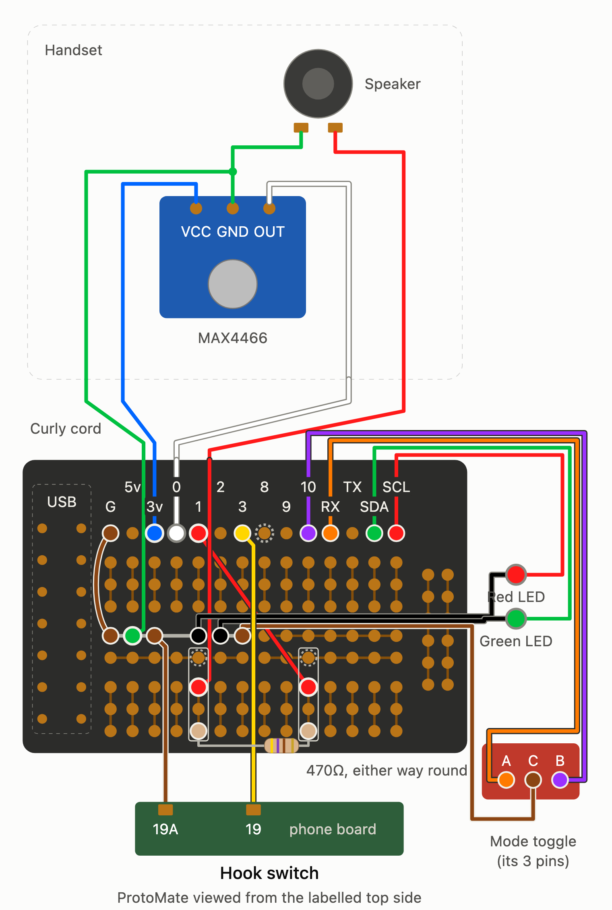

# Wiring

This page is the wiring reference for Hotline. The [build guide](build-guide.md) tells you when to make each connection.

An interactive copy of the diagram is in [`hotline_complete_wiring_v12.html`](hotline_complete_wiring_v12.html). Open it in a browser. It also has a dark mode.

## Pin map

The ProtoMate is drawn from its labelled top side. Its silkscreen uses XIAO pin names; the QT Py RP2040 has the same footprint.

| ProtoMate pad | QT Py pin | RP2040 GPIO | Connection | Wire colour |
| --- | --- | --- | --- | --- |
| G | GND | | Link to the ground rail | brown |
| 5v | 5V | | Not used | |
| 3v | 3V | | MAX4466 VCC (mic supply) | blue (cord) |
| 0 | A0 | 29 (ADC3) | MAX4466 OUT (mic signal) | white (cord) |
| 1 | A1 | 28 | Earpiece PWM, through the bridge wire and the 470 ohm resistor | red (bridge) |
| 2 | A2 | 27 | Not used | |
| 3 | A3 | 26 | Hook switch, phone board terminal 19 | yellow |
| 8 | SCK | 6 | Not used by Hotline | |
| 9 | MI | 4 | Not used | |
| 10 | MO | 3 | Mode toggle, outer pin B | purple |
| RX | RX | 5 | Mode toggle, outer pin A | orange |
| TX | TX | 20 | Not used | |
| SDA | SDA | 24 | Green LED, coloured lead | green |
| SCL | SCL | 25 | Red LED, coloured lead | red |

The hook switch and the toggle use the RP2040's internal pull-up resistors. Each input reads low when its switch closes to ground.

Check the labels on your ProtoMate. Boards up to version 1.2 have the labels 8 and 9 swapped. On later boards the labels read 8, 9, 10 in order.

## ProtoMate layout

- **Top row:** the labelled pads. Each pad connects to its QT Py pin only, not to the holes below it.
- **Upper and lower blocks:** 3 rows each. The 3 holes in each column connect together.
- **Two middle rows:** horizontal rails. Each rail is split into a left half and a right half.
- **Right side:** two vertical rails. Hotline does not use them.

In this guide the rows have letters: A is the labelled row, B to D are the upper block, E and F are the middle rails, and G to I are the lower block. The columns are numbered by the pad above them (column 1 is under pad 1).

## Ground rail

The left half of the upper middle rail (row E) is the only ground rail. Link it to the G pad. Every ground goes here, left to right:

1. G link (brown)
2. Green cord wire (mic ground and earpiece return)
3. Hook switch, phone board terminal 19A (brown)
4. Spare
5. Red LED, black lead
6. Green LED, black lead
7. Mode toggle, centre pin (brown)

## Earpiece resistor

The earpiece connects to pad 1 through a 470 ohm resistor:

- Solder a 1x4 female header on 1F to 1I, and another on 10F to 10I.
- Fit a red bridge wire from 10G to pad 1 (1A).
- Fit the 470 ohm resistor between 1I and 10I. A resistor has no polarity, so it fits either way round.
- The red cord wire plugs into 1G.

The signal path: pad 1 → bridge → column 10 (G to I) → resistor → column 1 (G to I) → red cord wire → earpiece. The lower-block columns do not connect to the labelled pads, so pad 10 (the toggle) is not affected.

Caution: header pins 1F and 10F sit on the lower middle rail (row F), which is split into halves. 1F joins the lower-left rail to the red-wire side, and 10F joins the lower-right rail to the pad 1 side. Keep both lower rails empty, or do not solder those two header pins. The ground rail (row E) is not affected.

## Curly cord

The original 4-wire curly cord connects the handset to the base. All the original handset circuitry is disconnected.

| Cord wire | Handset end | Base end |
| --- | --- | --- |
| Blue | MAX4466 VCC | Pad 3v |
| White | MAX4466 OUT | Pad 0 |
| Green | MAX4466 GND, and on to one earpiece terminal | Ground rail |
| Red | The other earpiece terminal | 1G (→ 470 ohm → bridge → pad 1) |

The earpiece has no polarity. Fit male pins to the base ends of the cord wires, so they plug into the female headers and the ground rail on the ProtoMate.

The green wire is the ground for the mic and the return for the earpiece. With only 4 wires in the cord, they must share it. The firmware times its mic readings so that the earpiece current does not disturb them (see [Firmware](firmware.md#timing)).

## Hook switch

Use the phone's original hook switch, through its screw terminals on the original phone board (GPO 746 terminals 19 and 19A):

- Terminal 19 → pad 3 (yellow).
- Terminal 19A → ground rail (brown).

Crimp a fork lug on each wire, and fit it under the terminal screw, as the original wiring does. Do not cut anything: the original circuit stays in place. With no telephone line connected, it has no power.

The switch closes when you lift the handset. If yours opens instead, set `HOOK_LIFTED_LEVEL` to 1 in `firmware/src/config.h`.

Warning: never connect the phone to a telephone line again. The line voltage, and the ringing voltage, can injure you and damage the QT Py and the Mac.

## Mode toggle

The toggle is an SPDT ON-OFF-ON latching switch with 3 pins in a row:

- Outer pin A → pad RX (orange).
- Centre pin C → ground rail (brown).
- Outer pin B → pad 10 (purple).

The centre pin must go to ground. The two outer pins can change places: if left and right are the wrong way round, swap `PIN_TOGGLE_LEFT` and `PIN_TOGGLE_RIGHT` in `firmware/src/config.h`. In the middle position, both pins read high.

## LEDs

The LEDs are 3 mm, prewired for 12 V, with a built-in resistor (about 500 ohm). At 3.3 V, red and green LEDs still light well with no extra resistor. Blue and white LEDs would be very dim.

- Green LED: coloured lead → pad SDA, black lead → ground rail.
- Red LED: coloured lead → pad SCL, black lead → ground rail.

The LEDs fit in the Top Panel, next to the toggle. Test each LED on the QT Py 3V and GND pads before you fit it. The firmware sets the brightness (`GREEN_LED_PERCENT`, `RED_LED_PERCENT`).

## USB

The QT Py's own USB-C socket is the only USB connection. A short 90-degree USB-C extension cable (male to female) goes from the QT Py to the back of the phone, where the Back Port parts hold its female end. Use a USB-C data cable from there to the Mac.
